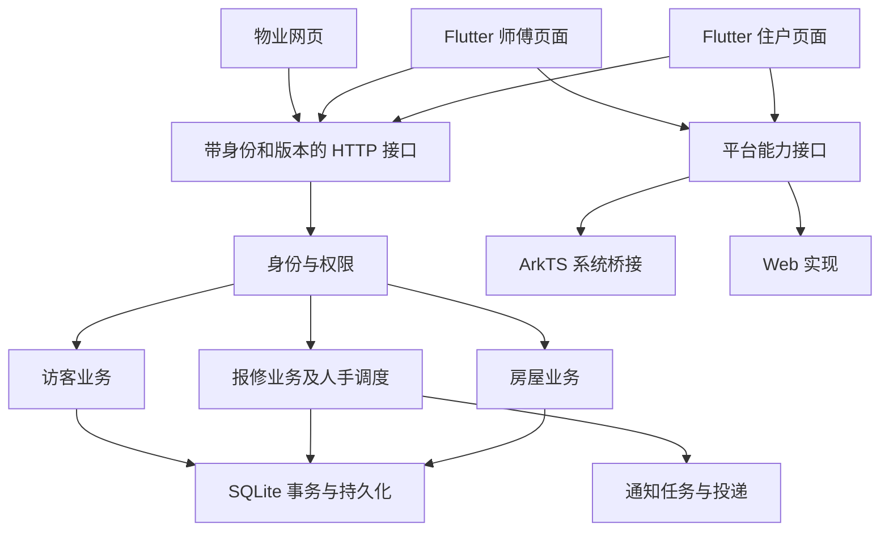

# Haven Hub 业务架构与技术栈分配方案

核对日期：2026-11-05。

状态：已实施客户端报修提交流程抽取和服务端住房模块归并，其余拆分仍为设计建议；源码基准为提交 `47dfdf09e90930630921299ce2b481098cde7653` 及当前工作区，两次实施结果见第 7 节。

建议主线：先明确业务数据归属、必须一起成功的操作和真正需要替换的能力，再形成“业务模块化单体＋模块内部按复杂度分层＋平台能力适配＋显式装配入口”；当前技术栈是过渡基础，不是未经比较就认定的最终最优方案。

首期范围沿用 `docs/enterprise_readiness_goals.md` 已记录的单小区、独立部署和独立数据库；真实负载与设备要求尚未确定，因此这里不承诺容量，也不预设多小区共库。

## 0. 复核后修正的判断

上一版主要回答了“现有技术分别做什么”，对“为什么这样拆、哪些不能拆、换技术什么时候才值得”回答不足，尤其不能把移动文件等同于架构升级。

| 上一版需要补充或修正的地方 | 复核后的判断 |
| --- | --- |
| 业务清单没有充分解释拆分依据 | 先判断数据归谁修改、哪些规则共同变化、哪些检查必须在同一事务中完成，再划模块 |
| 最终摘要把 Express 写成业务规则的负责人 | Express 负责 HTTP 接入；业务规则由普通 TypeScript 模块负责，逐步减少它们对 HTTP 错误形状和数据库通用记录的依赖 |
| 没有区分住房登记和物理房产台账 | 当前 rooms 主要是账号提交的住房登记资料，包含证件、审核和地址，并非独立的楼栋房间资产台账 |
| 外部能力替换与整块业务启停的区别不够具体 | TokenStorage、PushTransport 证明部分外部实现可替换，不能证明报修等完整业务可卸载、单独部署或热更新 |
| 首个切口优先选择了完整房屋拆分 | 首个验证切口改为报修提交与结果恢复流程：它已有应用内实际调用与测试替身，可直接检验复杂逻辑能否离开页面独立验证；通过后再推广到其他业务 |

取舍顺序：先保持已经定义的业务行为，再减少修改一个规则所牵连的位置，再增加有实际用途的组合方式，最后才考虑更换框架和部署方式。

## 1. 总体架构

采用模块化单体：后端仍是一套应用和数据库，内部按业务划分；住户、师傅、物业使用同一套业务规则，各自有对应页面和权限，维修内部的调度与人员能力可以分成子模块，但仍由同一业务操作协调事务。

业务决定谁负责，技术决定怎么实现，角色决定谁能看和操作；不能因为有三个角色就做三套报修规则，也不用给每个业务换一套框架。

| 可选路线 | 能解决什么 | 本项目的代价与当前结论 |
| --- | --- | --- |
| 继续只按 pages、api、utils 等文件类型组织 | 不需要迁移现有入口 | 同一流程的状态和规则仍分散；可作为过渡目录，不作为最终职责划分 |
| 业务模块化单体 | 把一个业务的规则、状态和数据修改收在明确入口之后，同时保留本地事务 | 需要梳理现有依赖和副作用；最符合当前已有实现及单小区范围，作为主线 |
| 业务插件框架 | 根据配置装卸整块业务 | 要额外处理依赖、迁移、权限、未结事项和版本兼容；目前尚无两套实际产品组合来检验通用协议，暂不建设插件管理器 |
| 微服务与分库 | 支持确有需要的独立部署与资源隔离 | 会把本地原子操作变成跨进程协调；没有独立团队、独立发布或实测扩容需求作为依据，当前不选 |

独立实现、独立测试、独立启用和独立部署是四种不同能力；当前先争取前两种，再验证明确的功能组合，不把它们一次性绑定。



图中省略了公告和运维入口，表达主要请求路径与平台调用，不是代码 import 关系；身份校验通过后由路由转交业务服务，不由认证模块反向依赖业务模块，也不表示这些职责已经全部独立封装。

## 2. 业务分工

| 模块 | 负责什么 | 对其他模块提供什么 | 当前落点及调整建议 |
| --- | --- | --- | --- |
| 身份与会话 | 验证码、登录、当前身份、角色、凭证刷新与退出 | 已验证的用户身份、会话变化、权限判断 | `lib/api/user.dart`、`tokenManager`、`UserInfoController`、`server/src/auth.ts`；人员停用涉及的凭证撤销仍须与人员业务协同 |
| 住房登记 | 选房草稿、账号提交的住房资料、创建回执、编辑、审核与删除 | 登记记录归属校验、地址及审核状态快照 | Flutter 沿用 house 页面；服务端登记、回执、编辑、删除和审核已归并到 `HousingService`，仍是账号住房登记，不是物理房产台账 |
| 报修 | 提交、预约、派单、履约、确认、取消、售后、版本冲突 | 工单视图、允许的动作、执行结果、通知任务描述 | `lib/pages/repair/` 与 `server/src/repair/`；住户、师傅、物业共用状态规则，客户端展示结果而不另造一套判定 |
| 维修人手 | 技能、请假、可用性、接单资格及调整影响 | 供报修调度使用的人手快照和冲突结果 | 当前分布于 `workflow.ts`、`repair/workforce.ts` 等；先作为维修业务内部模块，不拆成独立服务 |
| 访客 | 邀请、有效信息、创建回执、通行证图片 | 邀请记录、通行证和分享内容 | `lib/pages/visitor/`、`lib/api/visitor.dart` 与 `CommunityService`；建议抽出访客服务，系统分享留在平台层，不把通行码生成等同于门禁接入 |
| 公告 | 公告列表与详情 | 可展示的公告内容 | `lib/api/home.dart`、首页和详情页、服务端静态公告；维持简单读链路，尚不增加内容管理系统 |
| 通知 | 站内通知、已读、设备订阅、领取、重试与投递 | 通知查询和投递状态 | `notifications.ts`、`push-transport.ts`、Flutter 通知页面与推送平台封装；何时产生报修待办仍由报修规则决定 |
| 媒体 | 上传、用途绑定、授权读取与图片处理 | 带用途和访问约束的图片引用 | `media.ts` 与现有上传入口；房屋证件图、报修图、访客图不能因为共用组件就失去用途隔离 |
| 管理与运维 | 操作审计、监控、维护、备份恢复、发布检查 | 可追溯记录及运维结果 | `management-audit.ts`、`operations` 系列、备份工具；物业页面调用各业务模块，运维凭证保持独立 |

房屋、报修、访客各自拥有创建回执的含义；回执标识生成可以复用，关闭提交、已删除记录和工单状态的规则不能直接合成一个万能提交模块。

这里存在三个影响未来架构、但不能擅自补成需求的业务问题：

- 房屋是否必须审核通过才能报修或邀请访客：当前两个创建路径检查记录归属，没有把审核通过作为前置条件；重构不能顺手改变这项行为。
- 同一自然人能否兼任住户、师傅或物业：当前 `users.role` 为单角色，维修人员登记也拒绝复用其他角色的手机号；“模块自由组合”不等于已支持一个账号自由切换角色。
- 将来是否管理小区统一房产、家庭成员及租住关系：现有登记记录不能直接代表这套模型；若确有需求，需区分物理房间、账号与居住关系，不能只给现有 JSON 增加一个小区字段了事。

报修和访客当前会保存地址展示快照；拆出登记模块后仍需保留这一含义，不能把所有历史记录改成永远读取最新地址。

## 3. 技术栈分工

| 技术或已有封装 | 分配给什么职责 | 使用规则 |
| --- | --- | --- |
| Flutter OH / Dart | 住户与师傅页面、表单、交互及客户端流程 | 沿用工程已有的鸿蒙与 Web 入口；新增平台必须另行补齐工程和验证 |
| setState | 单页输入、展开收起、加载与错误展示 | 简单页面继续使用；复杂流程可移入普通 Dart 控制对象，通过现有回调更新页面，不为一个按钮新增全局状态 |
| GetX | 已有的用户资料、跨页面选房流程的展示订阅 | 保留现有调用兼容；新抽出的业务规则和流程对象不继承 GetxController，避免把能否测试和复用绑定到状态框架；不再把新流程默认注册成永久全局对象 |
| Dart 函数 / 流程对象 | 多步提交、恢复、分页与迟到响应管理 | 输入依赖通过构造参数或已有 loader 传入；简单读取不强行叠加 ViewModel、UseCase、Repository 三层转发 |
| `requestDio` / `HttpPath` | Flutter HTTP、鉴权头、错误归一和请求恢复 | `lib/api/` 保持业务接口入口；页面不直接创建 Dio，不处理 DioException，不重复实现凭证刷新 |
| `tokenManager` / `TokenStorage` | 凭证和会话生命周期 | 页面只用现有入口；鸿蒙安全存储通过 ArkTS Asset Store 桥接，其他平台现有实现不因此自动获得同等安全保证 |
| SharedPreferences | 现有草稿、回执及少量本地状态 | 保留账号隔离、损坏检测和落盘失败处理；不用它保存服务端权威工单状态，不绕过 tokenManager 写凭证 |
| ArkTS / MethodChannel | 系统分享、系统推送、安全凭证存储 | 系统差异藏在 `lib/platform/` 和原生插件后；纯业务审批和报修状态不搬到 ArkTS |
| Node.js / TypeScript | 后端运行环境、业务编排和业务规则 | 预约、取消、审核等规则属于普通 TypeScript 模块；现有动作已不直接访问数据库和系统时钟，但仍有通用记录类型与 HTTP 错误耦合，需要逐步收敛 |
| Express / Zod | HTTP 路由、请求解析、输入校验和结果映射 | 路由把已验证的身份与命令交给业务模块；业务权限和状态校验不能仅在路由检查一次；保留既有 HTTP 状态及业务错误码兼容 |
| SQLite / `Store` | 业务数据、回执、版本和短事务 | 当前先保留；跨业务的关键写入仍在同一事务里完成，外部网络等待不放在事务中 |
| 原生 HTML / CSS / JavaScript | 物业审核、派单、容量和人员工作台 | 先按业务拆分现有脚本，保留登录、权限、版本和异步保护；本次不追加 Vue 或 React 迁移 |
| `SmsSender` / `PushTransport` / 地图封装 | 短信、推送、腾讯及高德位置查询 | 同类能力在这里替换实现；提供者差异、失败含义、坐标系和调用成本由对应封装处理 |
| Flutter test / Node test / PowerShell 检查入口 | 单业务回归、跨端契约及隔离联调 | 复用已经按业务归类的测试与 `tool/check_project.ps1`，不为架构升级另造一套检查体系 |

版本依据是仓库固定配置，不是“升级到最新”：`tool/toolchain.json` 记录 Node 24.16.0 和 Flutter OH 修订 `244a0e8abb3085e8675589b13e219af8c41cb7aa`；实际依赖由两端锁文件决定，`pubspec.yaml` 的版本范围不等于当前解析版本。

### 3.1 保留现有技术有条件，不是结论先行

| 选择 | 当前保留依据 | 什么证据会使选择改变 |
| --- | --- | --- |
| Flutter OH，而非立即把全部页面改成 ArkUI | 已有住户和师傅页面、鸿蒙与 Web 入口、平台桥接及回归基础 | 若目标明确只做鸿蒙，且关键系统能力、交互或性能被现有适配持续阻塞，应选一条真实流程与原生 ArkUI 对比，再决定是否迁移 |
| 现有状态更新方式，而非立即全量改 Riverpod 或 Bloc | 当前主要问题是流程状态留在页面、全局依赖和状态归属混杂，换库不能自动解决 | 先在同一流程、同一组行为测试上证明生命周期、状态传播或维护成本有明确改善，才扩大替换 |
| Express，而非先迁 NestJS 等后端框架 | 路由、输入校验、鉴权和测试入口已经存在；混合业务职责可以在当前框架内修正 | 出现明确的团队约束、统一模块治理或重复基础能力成本，并经小范围对照验证后再选型；不把装饰器或目录规范当成业务解耦 |
| 物业原生网页，而非立即迁 Vue 或 React | 现有功能可保留，先验证同一业务脚本能否独立组织 | 若多页面共享复杂表单和交互状态反复出错，选择一页对照组件框架的实现与回归成本；当前未做该对照，不能声称原生脚本长期最优 |
| SQLite，而非立即迁 PostgreSQL | 现有事务、迁移、测试和备份已围绕单机存储实现，暂无当前试点负载证明必须替换 | 多实例写入、恢复目标、查询规模或写等待不能满足明确要求时再迁移；具体要求和测量均不能省略 |

按业务复杂度分层：公告保持简单读取；住房登记和访客增加实际需要的事务编排；报修履约保留规则、动作、编排和持久化分工；短信、推送、地图及系统能力走可替换实现，不给每个模块强制套相同数量的层。

### 3.2 状态必须有明确归属

| 状态 | 谁拥有 | 组合和升级时的约束 |
| --- | --- | --- |
| 工单状态、预约占用、审核结果、业务 revision | 服务端业务模块 | 客户端仅持有视图，不自行宣布业务成功或覆盖更高版本 |
| 当前登录会话、凭证代次 | `tokenManager` | 会话身份与凭证刷新代次保持区别；用户资料控制器不能再形成另一套独立登录真相 |
| 当前可编辑表单、待确认提交快照与回执 | 对应业务流程及其持久化存储 | 已发送内容不能被后续输入覆盖；持久化按已确认账号归属，运行中的迟到结果另用 sessionId 和请求代次拦截 |
| 预加载、分页及写入返回的完整列表 | 业务查询缓存 | 是可丢弃的派生数据；页码、筛选、账号必须区分，分页结果不能混进完整列表；换号和写入后明确失效 |
| 焦点、弹窗、动画、展开收起 | 页面 | 随页面释放，不塞入业务模块或全局容器 |

当前 `lib/api/repair.dart` 同时管理 HTTP、预加载和写响应缓存，因此它还不是纯传输层；目标是让现有函数继续作为兼容入口，把查询与提交流程的状态所有权逐个收回对应业务对象，而不是重新叠一层只转发的 Repository。

## 4. 依赖方向与目录安排

客户端：页面 → 需要时才抽取的业务流程对象 → `lib/api/` 的业务函数 → `requestDio`；平台操作通过现有平台封装，草稿与会话操作通过各自存储入口。

服务端：路由 → 业务服务 → 纯规则及业务数据访问 → `Store`；启动入口负责把依赖接起来，跨模块调用走明确的业务方法。

这表示责任归属，不要求一次搬目录：继续使用 `lib/pages/`、`lib/api/`、`lib/models/`、`lib/controller/`、`lib/platform/`，已有工具名称和调用入口保持兼容；新流程对象放在对应业务的 controller 子目录，实际出现职责时才创建。

服务端保留已有 `repair/`，住房模块已落在 `housing/`，包含输入与结果类型、业务服务和 HTTP 路由；原 `CommunityService`、`WorkflowService` 的住房专用入口已移除，已知调用方已迁移；访客仍在社区服务，后续有实际组合需求时再抽出。

目标把应用级依赖选择集中在客户端 `AppInitializer` 和服务端 `createApp`，会话或页面级流程再由对应工厂按需创建并释放；每个业务对外暴露必要的命令、查询及类型，调用方不通过全局查找随时取走其内部对象，这不需要先建设一个通用模块注册框架，也不表示当前初始化器已经实现这些装配职责。

当前 `Store` 并不是纯数据库底座：它导入报修默认规则、执行媒体绑定，并在保存报修时触发通知回调；未来应把连接和事务能力与这些业务操作区分，但必须先列全保存路径，再按业务逐个迁移，不能直接删除回调。

目标是在对应业务的持久化操作中明确编排媒体绑定和必要副作用，数据库连接只提供技术操作；历史迁移仍由版本化启动流程执行，不因当前是否展示某个功能而跳过已有数据的迁移。

依赖约束如下：

- 页面不导入另一个页面的 State 并修改其数据；跨页选择传递编号和结果，列表刷新沿用现有返回值与变更通知。
- 报修、访客只向房屋模块索取所需的归属及房屋信息；不能由房屋模块反过来驱动所有业务，已有报修兼容转发单独标记并逐步收敛。
- 维修人手和调度目前需要一致的修改结果，先保留同进程和事务协调；不为消除一条 import 而引入远程调用。
- 服务端权限仍对每次操作校验身份、归属和角色；前端隐藏菜单不是授权。
- `sl` 目前只注册核心依赖，不是插件系统；新增可替换依赖优先沿用构造参数和函数注入，已有全局工具不因此重建第二份实例。
- `AppPrompt`、错误类型、会话和 HTTP 恢复属于公共约定；报修预约、返修期限和房屋审核属于业务规则，不继续堆入通用工具。

发布接口逐步使用明确的业务类型，而不是继续把 `RecordData` 的任意键扩散到新调用方；HTTP 错误映射留在接入适配处，纯规则只描述业务拒绝，迁移期间保留原有错误码和先授权后报版本冲突的顺序。

## 5. 组合约定

目标是开发和构建时能选择兼容实现、业务之间能稳定配合；本阶段不设计运行中下载模块、热替换代码或无依赖约束的插件市场。

| 组合内容 | 必须保持的约定 | 明确不能这样组合 |
| --- | --- | --- |
| 换安全存储实现 | load、读写、清除、失败结果、串行顺序、换号后旧结果失效 | 安全存储失败后悄悄降级成明文并继续登录 |
| 换短信或推送提供者 | 同一业务输入、规范化失败、重复处理策略及生命周期 | 把“提供者已接收”当作“用户已收到” |
| 换房屋展示或选房实现 | 房屋编号、归属、版本和流程结果 | 仅凭地址字符串就跳过服务端归属校验 |
| 组合报修、房屋与人手 | 同次操作的身份、权限、工单版本、容量和人手冲突检查 | 将原来同一事务的检查与占用拆成不受保护的两次操作 |
| 切换账号或关闭页面 | 旧会话请求不得写入新账号状态，监听和重试有释放时机 | 只统一方法名，却丢掉生命周期与迟到响应处理 |
| 升级接口或本地存储格式 | 返回类型、错误码、回执、revision、迁移和兼容策略 | 只更新客户端类型声明就认定旧版本仍兼容 |

接口不仅是参数和返回值，还包括权限、顺序、错误、重试、版本及副作用；数据库事务、通知补偿和身份隔离也是组合规则。

当前通知同步已有保存点和失败后重建路径，不能为实现“报修与通知解耦”随意改变失败是否回滚工单的含义；如以后要求通知任务与工单必须原子提交，应单独设计并验证该语义变更。

### 5.1 这些操作不能因为拆模块就拆开提交

| 操作 | 需要保持的原子性或明确顺序 |
| --- | --- |
| 预约或接单 | 在同一事务内复核版本、时段容量与人员冲突，再写入工单；提前查询可选时段只是提示，不是预占成功 |
| 有回执的创建 | 去重检查、内容一致性检查、业务记录和回执共同提交；未知结果不代表失败，不得自动换回执再创建 |
| 房屋审核 | 检查当前版本和待审核状态、写入审核结果、递增版本并记录审计，保持既有事务 |
| 停用师傅 | 先检查未结工单，再协调账号状态、会话撤销、通知设备、人员影响与审计，不能通过多个无保障事件各自完成 |
| 报修变更与到期结算 | 保留先独立提交到期结算、再执行用户动作的现有顺序；用户动作失败不能撤销已生效的到期结算 |
| 工单与通知 | 正常同步随外层事务提交；同步自身失败只回滚保存点，保留工单并记录失败；外层事务失败时其中已写入的通知也必须回滚 |

其中后两项已由本轮定向测试核对，不能简单概括成“所有东西同一个事务”或“所有副作用提交后异步处理”。

### 5.2 自由组合的范围

下表是目标组合约束，当前仓库还没有实现这些独立启停配置。

| 期望组合 | 必需依赖 | 可独立替换或有条件降级 |
| --- | --- | --- |
| 住房登记与审核 | 身份、登记记录、证件媒体、物业权限和审计 | 定位选房可保留人工填写替代，但登记校验仍执行 |
| 社区报修 | 身份、登记归属查询、报修规则、容量与人手、待办、相关媒体权限 | 系统推送不可用时仍保留站内待办，不能因此取消业务确认步骤 |
| 访客邀请 | 身份、登记归属查询、邀请回执、图片生成及授权读取 | 分享方式可换；本地演示通行码不能直接替换成真实门禁授权 |
| 师傅工作台 | 维修身份、报修查询与动作权限、人手规则 | 页面表现可换，不能脱离报修服务成为独立业务闭环 |
| 通知投递提供者 | 标准化投递输入、设备归属、结果和重试约定 | Web Push 与鸿蒙推送分别实现；不能把它们的凭证和失败状态混用 |

后续若真的出现两种需要长期维护的产品组合，再用它们检验模块依赖、停用后的旧数据读取和迁移顺序；功能菜单开关只控制展示，不等于卸载业务。

新增可关闭业务时，必须同时处理入口、接口授权、依赖和未结事项；例如不能仅隐藏师傅工作台，就声称维修调度模块已经安全卸载。

## 6. 实施顺序

以下是分阶段改造顺序；阶段 1 的报修提交流程试点及阶段 2 的住房职责归并已完成，Store 副作用归属整理与阶段 3—4 尚未完成。

| 阶段 | 改什么 | 通过什么才进入下一阶段 |
| --- | --- | --- |
| 0：固定行为与范围 | 记录业务问题、状态所有权和事务语义，保留当前改动；已运行项目基线并记录既有分析提示 | 后端 664 项、改造前报修 271 项通过；完整基线在 3 处既有测试格式提示处停止，不能认定整个检查链已通过 |
| 1：验证一个有深度的模块 | 抽取报修提交与结果恢复流程，保留原页面、HTTP 地址、草稿格式及现有注入入口 | 页面只需读取流程状态和发出命令；流程可脱离 Widget 使用真实实现和测试替身验证，关键场景通过且没有多处状态重复维护 |
| 2：整理业务数据与写入职责 | 已收拢住房登记、审核及回执，并明确住房写入和审核结果类型；Store 中媒体绑定和通知钩子的职责整理仍待实施 | 本次全量回归通过，住房事务与 HTTP 契约保留；未覆盖路径不得先移除旧钩子，详见 7.2 |
| 3：验证实际组合 | 有明确组合需求时再抽访客入口、整理维修人手接口和物业脚本，显式连接依赖与生命周期 | 至少有具体组合的依赖检查和行为测试；不可用能力、换号、旧数据与未结事项都有确定结果 |
| 4：性能或部署升级 | 根据真实试点的请求延迟、写等待、数据量、备份恢复时间决定是否改查询、存储或部署 | 相同负载的前后对照和迁移恢复演练通过，不能凭文件变多或框架更新认定升级成功 |

首个模块 `RepairSubmissionFlow` 已实现在 [repair_submission_flow.dart](../lib/controller/repair/repair_submission_flow.dart)；它校验绑定账号及会话、准备并持久化提交快照、发送、查询结果、显式重试和停止未确认提交，页面保留身份资料加载、输入控件、表单校验、时段刷新、提示与导航。

选择它的依据是表单已暴露 submitter、submissionLoader、submissionCloser、draftStore 等真实替换点，改造前状态协调仍在 Widget 中；已有测试覆盖保存失败不发送、原内容重试、重开恢复和账号隔离，本次沿用这些入口，将回执、提交结果与操作互斥的状态协调移入普通 Dart 对象。

该切口的验收包括：修改提交恢复策略时不再改布局；保存快照失败不发请求；超时保留未知结果；编辑不改变旧提交内容；换号不接收旧结果；关闭页面释放监听但不丢失已保存回执；原页面交互与服务端去重契约保持一致。

接口行为测试应减少对私有字段和文件摆放的依赖；替代旧测试时逐项核对行为覆盖，既不能堆两套重复测试，也不能仅因测试数量多就删除已有回归。

未来如果多实例同时写入或写等待成为实测瓶颈，再评估 PostgreSQL 等服务端数据库；SQLite 每个数据库文件同一时刻只允许一个写入者，不能仅增加应用实例就假定能线性扩展 [O2]。

数据库替换会牵涉同步调用改异步、SQL、JSON 查询、迁移、事务、图片、备份及领取机制，不是只改一个连接配置；现阶段不先造通用数据库接口。

多小区扩展需重新确认身份所属小区、房屋归属、查询范围、媒体权限、调度范围和运维隔离；现有地图检索的 communityId 不等于后端已具备租户隔离。

## 7. 本次核对与证据

设计复核阶段重新核对了业务读写、状态来源、事务和历史提交；在 Node 24.16.0 下运行了 10 项既有定向测试，覆盖报修事务、授权与版本顺序、兼容响应和通知同步失败隔离，10 项全部通过。

首个试点新增流程对象及接口测试，并接入现有报修表单；随后按“继续升级模块化架构”的要求归并服务端住房职责，见 7.2；两次实施均未升级依赖或迁移数据库，未操作日常业务数据库、启动设备或进行真实推送，不构成完整架构迁移或设备验收。

设计复核阶段的命令，在 `server/` 目录执行：

```powershell
node --import tsx --test --test-name-pattern '^(refactor:|repair write atomically persists|FIX S-M2 notification sync failure)' test/repair/repair-refactor.test.ts test/notifications/notifications.test.ts
```

| 结论 | 当前证据 |
| --- | --- |
| Flutter OH 依赖及插件已有兼容约束 | `pubspec.yaml` [源码](../pubspec.yaml)、固定工具链 [源码](../tool/toolchain.json)；包含 image_picker_ohos 本地覆盖，不能直接批量升级插件 |
| 后端是 Express / TypeScript，并使用 SQLite | `server/package.json` [源码](../server/package.json)、`database.ts` [源码](../server/src/database.ts) |
| 报修已有可复用的内部职责划分 | `service.ts` [源码](../server/src/repair/service.ts)、`repository.ts` [源码](../server/src/repair/repository.ts)、`actions.ts` [源码](../server/src/repair/actions.ts)、`policy.ts` [源码](../server/src/repair/policy.ts) |
| 住房登记与审核已独立，访客与维修人手仍沿用现有入口 | 住房服务 [源码](../server/src/housing/service.ts)、路由 [源码](../server/src/housing/routes.ts)、应用装配 [源码](../server/src/app.ts)；剩余职责见 `community/service.ts` [源码](../server/src/community/service.ts)、`workflow.ts` [源码](../server/src/workflow.ts) |
| Store 存在业务副作用，纯规则仍带通用类型与 HTTP 错误语义 | 保存与迁移 [源码](../server/src/database.ts)、错误映射现状 [源码](../server/src/errors.ts)、报修动作 [源码](../server/src/repair/actions.ts) |
| 报修传输入口也持有查询缓存，表单协调多个可替换依赖 | 报修 API [源码](../lib/api/repair.dart)、完整列表缓存 [源码](../lib/utils/mutation_list.dart)、表单 [源码](../lib/pages/repair/repair_form_page.dart) |
| 不同回滚边界已有可执行行为约束 | 已执行报修测试 [源码](../server/test/repair/repair-refactor.test.ts)、通知测试 [源码](../server/test/notifications/notifications.test.ts)；客户端原有提交交互测试 [源码](../test/repair/repair_submission_test.dart) 在试点前后均执行 |
| 报修提交与结果恢复已从页面分离 | 普通 Dart 流程 [源码](../lib/controller/repair/repair_submission_flow.dart)、接口测试 [源码](../test/repair/repair_submission_flow_test.dart)、页面接入 [源码](../lib/pages/repair/repair_form_page.dart)；导出兼容入口、页面构造注入参数和布局保持不变，其他页面流程仍按原方式组织 |
| 存储和投递已有真实替换点 | `TokenStorage` [源码](../lib/utils/token_storage.dart)、鸿蒙实现 [源码](../lib/utils/harmony_token_storage.dart)、`PushTransport` [源码](../server/src/push-transport.ts)、`SmsSender` [源码](../server/src/sms.ts) |
| 原生层主要接系统能力 | `EntryAbility.ets` [源码](../ohos/entry/src/main/ets/entryability/EntryAbility.ets) |
| 物业工作台目前使用原生网页脚本 | 网页入口 [源码](../server/public/admin/index.html)、业务脚本 [源码](../server/public/admin/app.js) |
| 可沿用已有验证入口 | 测试目录说明 [源码](../test/README.md)、统一检查脚本 [源码](../tool/check_project.ps1)；README 和测试说明中的历史数量有日期差异，本次不认定其为当前通过结果 |
| 单小区是当前文档记录的首期范围 | 生产化范围文档 [源码](enterprise_readiness_goals.md)；这是已有范围记录，不是本次重新向用户确认 |

### 7.1 首个试点的实际结果

本节保留首个试点完成时的检查记录；当时遗留的 3 处测试格式提示已在后续住房模块升级中修复，最新全量结果见 7.2。

报修新建页面已接入 `RepairSubmissionFlow`，提交、查询、按原内容重试和停止提交都通过同一个流程对象协调；页面构造参数与布局代码和实施前快照逐段比对一致，原有页面测试继续保留。

| 所有者 | 本次实际负责的内容 |
| --- | --- |
| `RepairSubmissionFlow` | 绑定账号与会话校验、最后一次可编辑内容快照、持久化回执、未知结果、提交互斥、错误归类、结果查询、明确同意后的原内容重试、服务端停止后的本地清理、成功后的草稿删除 |
| `RepairFormPage` | 加载账号资料和可选项、输入与照片、校验、旧草稿时段映射、时段复查、保存防抖、确认框、提示和导航；准备提交和等待确认属于页面交互状态，回执与提交成功状态只从流程读取 |
| 现有 API 和 `RepairDraftStore` | 沿用 `requestDio`、`HttpPath`、统一错误类型和既有草稿格式；存储继续负责写入排队及跨表单回执冲突检查，本次没有建立第二套存储或网络实现 |

流程通过构造参数接收网络、存储、所属账号校验和状态回调，不继承 GetxController，不持有 BuildContext，不负责提示或导航；页面离开前先交付输入快照并启动保存，再释放流程回调，迟到响应不能继续清理草稿或导航。

新增的 32 项接口测试不构建 Widget，使用现有 `RepairDraftStore`、模拟的 SharedPreferences 和网络替身；覆盖保存失败不发送、保存完成前互斥、错误分类、旧未知状态确认、快照防外部修改、跨表单冲突、查询与停止、账号或会话变化、释放后的迟到响应，以及成功后清理失败不能再次提交。

审查中补充复现并修复了一条遗漏路径：写入回执发生冲突，随后读取已保存回执也失败时，不能把尚未保存的新回执留作可重试提交；测试先观察到新回执仍然暴露，再验证修复后没有网络创建、原回执仍在磁盘，恢复读取后能够取得原回执。

| 2026-11-05 本次实际检查 | 结果与边界 |
| --- | --- |
| 完整项目基线 `check_project.ps1 -SkipRestore` | npm 安全审计 0 漏洞、后端构建、664 项后端测试和管理端脚本语法检查通过；在全量 Flutter 分析的 3 处既有格式提示处停止，整个脚本退出码为 1 |
| 改造前报修测试 | 271 项通过，保存了原页面与方案的实施前快照 |
| 最终新增流程测试 | 32 项通过，未使用页面或导航作为测试入口 |
| 最终全量 Flutter 测试 | 680 项通过、0 失败；默认关闭的本地后端集成测试有 1 项跳过，另行显式运行如下 |
| 独立本地后端集成 | 1 项通过，真实 Dart API、临时 HTTP 服务和隔离 SQLite 数据库完成往返；不是模拟器或真机验收 |
| 本次两个实现文件及新增测试的静态分析 | 0 问题 |
| 全量 `lib test` 静态分析 | 仍有基线相同的 3 处 `curly_braces_in_flow_control_structures` 提示，位于 `repair_phase_one_test.dart:238、284` 和 `repair_schedule_phase3_test.dart:237`；未为本次试点改动这些原有测试 |
| 页面兼容与局部审查 | 页面布局和构造注入参数未变；页面不再直接写回执、未知结果或成功状态，流程没有 UI 或全局会话依赖；已核对异步返回、账号隔离、草稿冲突和释放路径 |

主要复验命令，在仓库根目录执行：

```powershell
pwsh -File tool/flutter_ohos.ps1 test --no-pub --reporter expanded test/repair/repair_submission_flow_test.dart
pwsh -File tool/flutter_ohos.ps1 test --no-pub --reporter expanded
pwsh -File tool/flutter_ohos.ps1 analyze --no-pub lib/controller/repair/repair_submission_flow.dart lib/pages/repair/repair_form_page.dart test/repair/repair_submission_flow_test.dart
pwsh -File tool/flutter_ohos.ps1 analyze --no-pub lib test
pwsh -File tool/test_local_backend.ps1 -SkipBuild
```

本机检查日志与实施前快照保存在 `C:\Users\23203\.codex\visualizations\2026\11\05\01a1a9d8-0db3-7912-881d-f7346328cdab\repair-flow-pilot`；这次验证了一个流程可以独立组合和测试，没有证明整个项目已经支持任意模块热插拔、跨产品组合或独立部署，后续住房模块实施结果如下。

### 7.2 服务端住房模块的实际结果

`HousingService` 已统一负责住房登记、编辑、删除、提交回执和物业审核，通过构造参数接收 Store、媒体地址和时钟，可直接调用并独立测试，不依赖 Express、CommunityService 或 WorkflowService；`app.ts` 显式创建服务并在鉴权、版本和管理权限中间件之后挂载住房路由。

模块只新增三个实现文件：输入校验和结果类型 [源码](../server/src/housing/model.ts)、业务与事务 [源码](../server/src/housing/service.ts)、原有 HTTP 路由适配 [源码](../server/src/housing/routes.ts)；旧服务中的住房专用方法已移除，应用、演示脚本和测试均已切换到新入口，共用图片归属校验移入现有 `media.ts`。

沿用原有接口地址、响应结构、回执哈希、错误提示和版本规则；先核对房屋归属再比较版本，模块内部也检查审核人角色，登记写入、回执、媒体绑定与返回列表同成同败，审核结果与审计同一事务提交。

| 2026-11-05 后续升级检查 | 实际结果 |
| --- | --- |
| 住房模块直接测试 [源码](../server/test/house/housing-module.test.ts) | 新增 4 项通过，使用真实内存 SQLite，覆盖完整登记审核生命周期、直接调用权限、跨实例回执及停止提交、审计和响应构造失败回滚 |
| 定向回归 | 改造前 45 项、改造后 49 项通过；故障注入随业务入口迁移，保留原回滚断言 |
| 完整 `tool/check_project.ps1 -SkipRestore` | 退出码 0；依赖安全审计 0 漏洞、后端构建、668 项后端测试、管理端语法检查和 Flutter 工具链检查通过 |
| Flutter 分析与测试 | 全量静态分析 0 问题；680 项测试通过，默认跳过的 1 项本地后端集成另行运行通过，覆盖真实 Dart API、HTTP 和隔离 SQLite 往返 |

Store 的媒体绑定和报修通知钩子仍在原处，报修及访客的住房读取也尚未统一改经住房模块，访客服务与更广泛的组合能力仍未拆分；本次没有增加依赖、数据库迁移或通用插件框架，验证的是住房业务可以独立构造与测试，不能据此宣称已支持任意热插拔。

本机检查日志与实施前快照保存在 `C:\Users\23203\.codex\visualizations\2026\11\05\01a1a9d8-0db3-7912-881d-f7346328cdab\housing-upgrade`。

### 7.3 住房模块本地功能验收

2026-11-05 使用当前源码重新构建后端和 Flutter Web，在独立 SQLite、虚构账号及测试图片上验收；本轮没有修改业务代码。

| 验收入口 | 实际结果 |
| --- | --- |
| 定向自动化 | 49 项后端住房、审计和媒体检查及 134 项 Flutter 住房检查通过，覆盖回执恢复、账号隔离、版本冲突及失败回滚 |
| 真实 HTTP | 创建、原回执重试不重复建房、内容冲突、回执查询、越权拒绝、停止提交后迟到请求拒绝、客户端版本门禁均通过 |
| ego lite 浏览器 | 住户与物业登录、住房列表和详情、打回原因必填、打回后住户查看原因、修改姓名并重提、物业审核通过均正常；旧版本删除被拦截，刷新后确认删除成功，两端列表均清空 |
| 删除与留痕 | 删除回执保留为 deleted，重放旧创建回执拒绝重建，物业失去证件图片访问权；操作记录页保留两次审核，版本分别为 1→2 和 3→4 |

本轮结论为住房模块的本地功能验收通过；隔离构建未接入地图服务，住房创建经真实 HTTP 完成，不把“定位选小区到首次提交”的完整浏览器流程计入通过，也不代表鸿蒙模拟器、真机或生产环境验收；浏览器检查依据页面状态与操作结果，未取得可用截图，不计作视觉验收。

验收脚本、日志、页面状态记录和隔离数据库保存在 `C:\Users\23203\.codex\visualizations\2026\11\05\01a1a9d8-0db3-7912-881d-f7346328cdab\housing-acceptance`；浏览器验收任务已关闭。

### 7.4 真实地图到房屋表单及设备补充验收

2026-11-07 使用当前 Flutter Web 构建、项目现有地图配置、独立测试后端和用户指定的 QijuGuanjia API24 继续验收：

| 验收入口 | 实际结果 |
| --- | --- |
| 真实腾讯地图检索 | 按城市搜索“榴苑三街”返回“榴苑三街小区”，地址与佛山市禅城区榴苑三街相符；浏览器实际选择该结果 |
| 小区到楼栋 | 选择小区后加载楼栋候选；手动填写 3栋1单元 和 802，正常进入业主表单 |
| 业主表单 | 虚构姓名、手机号和房号进入页面状态，性别控件可见；仅使用隔离账号和标注 TEST ONLY 的示例图片 |
| 图片上传与首次提交 | 定位到 workflow 专用 CSP 缺少 `connect-src blob:`；补充该最小白名单并增加回归断言后，浏览器真实相册选择两张示例图片成功，房屋提交成功，列表显示待审核 |
| 物业审核闭环 | 物业工作台看到 1 条待审核资料，查看两张图片并点击通过；住户端刷新后显示“已通过” |
| 指定设备 QijuGuanjia API24 | 以 HDC `127.0.0.1:5557` 安装并运行当前 x64 Debug HAP；设备端验证码登录、地图搜索入口、城市搜索和楼栋/房号流程正常。相册选择器可打开但图库无示例图片；独立平台冒烟页的拍照入口返回“当前设备无法使用系统相机，请从相册选择图片”，房屋表单现已显示同样的可操作提示。模拟器启动日志记录 `camera irq not enabled`，但未确认其是否为唯一根因。未在设备端伪造照片提交 |

本次通过了真实地图搜索、浏览器图片上传、首次提交、物业审核、住户状态回读及指定设备的安装启动和前置流程。设备端照片提交未完成：图库为空，且该实例的系统相机入口报告不可用；没有生成、伪造或上传设备端测试照片，也没有提交设备端房屋申请。房屋表单原先把平台错误折叠成“上传图片失败”，现已修复为相机不可用时提示从相册选择，并在指定设备上复测通过；该修复改善错误反馈，不会启用模拟器未提供的相机能力。该限制不影响已完成的 Web 完整闭环，未将设备端流程标记为完整通过。

本次浏览器状态记录和隔离数据库位于 `C:\Users\23203\.codex\visualizations\2026\11\07\01a1b42a-9fd1-7930-87ba-c5212d0cff55`。

## 8. 官方资料与适用范围

[O1] Flutter 官方 Architecture recommendations and resources，2026-11-05 实际读取：建议分离页面与逻辑、隔离数据访问并注入依赖，复杂领域层按需引入；这些建议不要求现有项目立即更换 GetX 或引入所有分层，本方案按当前工程做了取舍。

来源：`https://docs.flutter.dev/app-architecture/recommendations`

[O2] SQLite 官方 Appropriate Uses For SQLite，2026-11-05 实际读取：写入密集、多服务器或无法排队的并发写场景，应考虑服务端数据库；这提供升级条件，不能代替当前项目的容量实测。

来源：`https://www.sqlite.org/whentouse.html`
